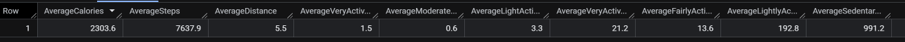
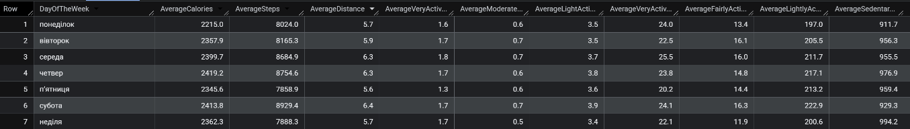
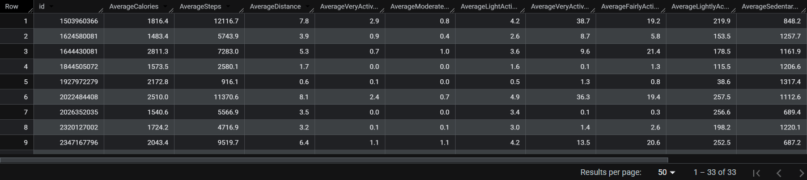
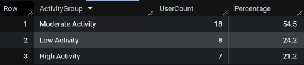
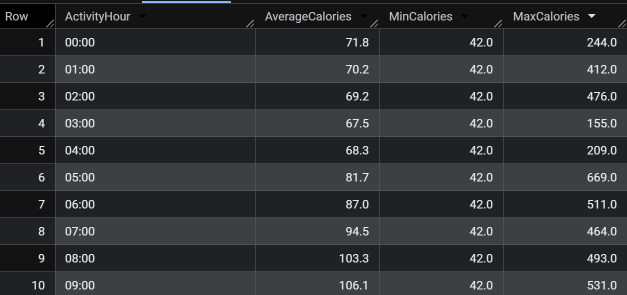
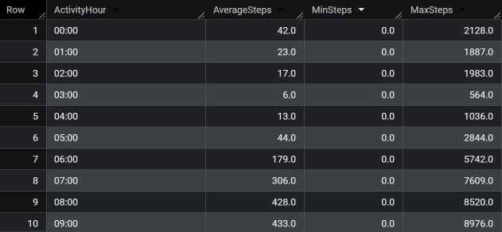
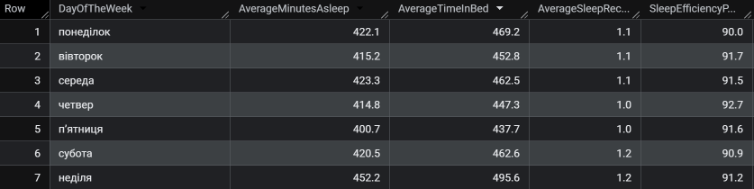
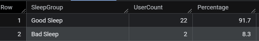
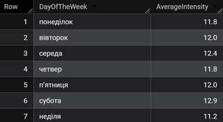
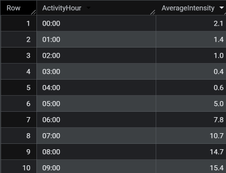

# Data-Analysis-Case-Study
## Аналіз FitBit Fitness Tracker Data отримуючи Google Data Analytics Professional Certificate
### 1. Умови
Під час отрмання Google Data Analytics Professional Certificate програма дає можливість створити власне дослідження на 2 теми на вибір. Я зосередився саме на FitBit Fitness Tracker Data, оскільки вона здалась мені цікавою за рахунок великої кількості метрик, які можна проаналізувати, знайти кореляцію та причинно-наслідковий зв'язок між ними та отримати інсайди.

Власне, вихідні умови такі: "Ви - молодший аналітик даних у команді маркетингової аналітики компанії Bellabeat, високотехнологічного виробника товарів для здоров’я, орієнтованих на жінок. Bellabeat — успішна невелика компанія, яка має потенціал стати значним гравцем на світовому ринку розумних пристроїв. Уршка Сршен, співзасновниця та директорка з креативних питань Bellabeat, вважає, що аналіз даних про фізичну активність, отриманих із розумних пристроїв, може допомогти компанії відкрити нові можливості для зростання. Вам доручено зосередитися на одному з продуктів Bellabeat і проаналізувати дані з розумних пристроїв, щоб зрозуміти, як саме споживачі ними користуються. Отримані висновки допоможуть сформувати маркетингову стратегію компанії. Ви представите результати аналізу керівництву Bellabeat разом із загальними рекомендаціями щодо маркетингової стратегії компанії."

Bellabeat має декілька продуктів, але тут я зосередився саме на Bellabeat app, оскільки застосунок Bellabeat надає користувачам інформацію про стан здоров’я, що стосується їхньої активності, сну, рівня стресу та менструального циклу. Ці дані допомагають користувачам краще зрозуміти свої звички й приймати рішення, корисні для здоров’я.

У цьому досліджені я використав 6 етапів аналізу даних:
* Ask
* Prepare
* Process
* Analyze
* Share
* Act

### 2. Ask
Завдання полягає у тому, щоб зосередитися на одному з продуктів Bellabeat і проаналізувати дані про використання розумних пристроїв, щоб зрозуміти, як саме люди вже користуються ними. На основі отриманої інформації потрібно зробити узагальнені рекомендації щодо того, як ці тенденції можуть вплинути на маркетингову стратегію Bellabeat.

До стейкхолдерів належать:
* Уршка Сршен: співзасновниця та директорка з креативних питань компанії Bellabeat
* Сандо Мур: математик і співзасновник Bellabeat; ключовий член управлінської команди Bellabeat.
* Команда маркетингової аналітики Bellabeat

### 3. Prepare
Для цього дослідження нам надали [📊 Fitbit Fitness Tracker Data на Kaggle](https://www.kaggle.com/datasets/arashnic/fitbit)

Цей датасет було сформовано на основі відповідей учасників опитування, проведеного через платформу Amazon Mechanical Turk у період із 12 березня по 12 травня 2016 року. Тридцять користувачів Fitbit дали згоду на надання персональних даних із трекера, зокрема показників фізичної активності, частоти серцевих скорочень і моніторингу сну з деталізацією по хвилинах. Проте, в ході аналізу було виявлено, що користувачів 33 у більшості файлів.

Сам датасет є публічним, тож я можу копіювати, змінювати, поширювати та публічно демонструвати його, зокрема й із комерційною метою, без отримання додаткового дозволу.

Власне сам датасет я завантажував zip-файлом, у якому було 18 csv-файлів. Оскільки файли відносно невеликі, я зміг відкрити та проаналізувати ці файли в Google Sheets. Для подальшого послідження я використав 6 файлів, бо саме з них можна було дістати необхідні інсайди, окрім того, більшість файлів - звіт по окремому показнику, котрі і так були представлені у merged файлах. Список використаних файлів:

* dailyActivity_merged.csv
* hourlyCalories_merged.csv
* hourlySteps_merged.csv
* sleepDay_merged.csv
* hourlyIntensities_merged.csv
* weightLogInfo_merged.csv

Щодо актуальності та достовірності даних, то можна констатувати, що жоден з цих показників не дотриманий. Дані були зібрані у 2016 року, тому є неактуальними. У датасеті немає жодних даних про вік, стать та місцезнаходження користувачів, а також сама вибірка є дуже малою (33 людини), що робить її нерепрезентативною для широкого загалу користувачів. Самі продукти Bellabeat орієнтовані на жінок, тож можна припускати, що абсолютна більшість користувачів це саме жінки, проте ми не можемо знати напевно.

### 4. Process
Під час цього етапу я очистив дані та привів їх до уніфікованого формату:
* Відсортував та відфільтрував дані (видалив порожні значення);
* Прибрав дублікати та пробіли;
* Змінив формат дат з mm.dd.yyyy на dd.mm.yyyy, створив окремі колонки які позначали дні тижня;
* Змінив годинний формат з tt на hh:mm;
* За необхідності розділив колонки mm.dd.yyyy tt на окремо dd.mm.yyyy та hh:mm;

### 5. Analyze
Вже очищені файли я аналізував у BigQuery та Jupyter Notebook. Тут я викладу аналіз саме за допомогою SQL, а ідентичні кроки, але вже за допомогою Python викладені тут [AnalysisPython](AnalysisPython.ipynb)

Також всі візуалізації я робив за допомогою Tableau. 

[Переглянути інтерактивні дашборди у Tableau Public](https://public.tableau.com/views/VisualizationofFitBitFitnessTrackerData/Dashboard1?:language=en-GB&:sid=&:redirect=auth&:display_count=n&:origin=viz_share_link)

З файлу dailyActivity_merged дізнався середні значення різних змінних:
```sql
SELECT 
  round(AVG(Calories),1) AS AverageCalories,
  round(AVG(TotalSteps),1) AS AverageSteps,
  round(AVG(TotalDistance),1) AS AverageDistance,
  round(AVG(VeryActiveDistance),1) AS AverageVeryActiveDistance,
  round(AVG(ModeratelyActiveDistance),1) AS AverageModeratelyActiveDistance,
  round(AVG(LightActiveDistance),1) AS AverageLightActiveDistance,
  round(AVG(VeryActiveMinutes),1) AS AverageVeryActiveMinutes,
  round(AVG(FairlyActiveMinutes),1) AS AverageFairlyActiveMinutes,
  round(AVG(LightlyActiveMinutes),1) AS AverageLightlyActiveMinutes,
  round(AVG(SedentaryMinutes),1) AS AverageSedentaryMinutes,
FROM core-almanac-504208-f8.fit_bit.dailyActivity_merged
```
Результат 


Дізнався середні значення різних змінних відповідно до дня тижня
```sql
SELECT 
  DayOfTheWeek,
  round(AVG(Calories),1) AS AverageCalories,
  round(AVG(TotalSteps),1) AS AverageSteps,
  round(AVG(TotalDistance),1) AS AverageDistance,
  round(AVG(VeryActiveDistance),1) AS AverageVeryActiveDistance,
  round(AVG(ModeratelyActiveDistance),1) AS AverageModeratelyActiveDistance,
  round(AVG(LightActiveDistance),1) AS AverageLightActiveDistance,
  round(AVG(VeryActiveMinutes),1) AS AverageVeryActiveMinutes,
  round(AVG(FairlyActiveMinutes),1) AS AverageFairlyActiveMinutes,
  round(AVG(LightlyActiveMinutes),1) AS AverageLightlyActiveMinutes,
  round(AVG(SedentaryMinutes),1) AS AverageSedentaryMinutes,
FROM core-almanac-504208-f8.fit_bit.dailyActivity_merged
WHERE DayOfTheWeek IS NOT NULL
GROUP BY DayOfTheWeek
ORDER BY 
  CASE 
    WHEN DayOfTheWeek LIKE 'пон%' THEN 1
    WHEN DayOfTheWeek LIKE 'вів%' THEN 2
    WHEN DayOfTheWeek LIKE 'сер%' THEN 3
    WHEN DayOfTheWeek LIKE 'чет%' THEN 4
    WHEN DayOfTheWeek LIKE 'п%'   THEN 5
    WHEN DayOfTheWeek LIKE 'суб%' THEN 6
    WHEN DayOfTheWeek LIKE 'нед%' THEN 7
  END
```
Результат 



Найменш активними днями тижня за кількістю кроків, калорій та відстанню є понеділок, п'ятниця та неділя, натомість найактивнішими для цих показників є середа, четвер та субота. Для хвилин високої інтенсивності наймеш активними є вівторок, п'ятниця та неділя, найбільш - понеділок, середа, субота. Для хвилин помірної інтенсивності найменш активними є понеділок, четвер, п'ятниця та неділя, а решта - найактивніші. Для хвилин легкої інтенсивності спостерігається поступове зростання від початку тижня, що спадає у неділю.

Потім я підрахував кількість окремих користувачів
```sql
SELECT 
  count(distinct(id))
FROM core-almanac-504208-f8.fit_bit.dailyActivity_merged
```
Їх виявилося 33.

Підрахував середні значення різних показників за день кожного користувача
```sql
SELECT 
  id,
  round(AVG(Calories),1) AS AverageCalories,
  round(AVG(TotalSteps),1) AS AverageSteps,
  round(AVG(TotalDistance),1) AS AverageDistance,
  round(AVG(VeryActiveDistance),1) AS AverageVeryActiveDistance,
  round(AVG(ModeratelyActiveDistance),1) AS AverageModeratelyActiveDistance,
  round(AVG(LightActiveDistance),1) AS AverageLightActiveDistance,
  round(AVG(VeryActiveMinutes),1) AS AverageVeryActiveMinutes,
  round(AVG(FairlyActiveMinutes),1) AS AverageFairlyActiveMinutes,
  round(AVG(LightlyActiveMinutes),1) AS AverageLightlyActiveMinutes,
  round(AVG(SedentaryMinutes),1) AS AverageSedentaryMinutes
FROM core-almanac-504208-f8.fit_bit.dailyActivity_merged
group by id
order by id
```
Результат 



Відсортувавши користувачів за к-стю спалених калорій можемо бачити, що наша вибірка є доволі різноманітною. Користувачі відрізняються не тільки к-стю спалених калорій а і шляхом їхнього спалення. Наприклад, користувач з найбільшою середньою к-стю кроків займає 2 місце, а користувач з найбільшою середньою к-стю хвилин високої інтенсивності займає 3 місце. Тобто середня к-сть спалених калорій - це сукупність різних видів активності, котрі пропорційно впливають на суму значень.

Я розділив людей на категорії за їхнім рівнем активності (за кроками >10к - висока, >5к - середня, решта - низька) з використанням тимчасової таблиці та порахував к-сть людей у кожній категорії та їхнє співвідношення.
```sql
WITH UserGroups AS (
  SELECT 
    id,
    AVG(TotalSteps) AS AverageSteps,
    CASE 
      WHEN AVG(TotalSteps) >= 10000 THEN 'High Activity'
      WHEN AVG(TotalSteps) >= 5000  THEN 'Moderate Activity'
      ELSE 'Low Activity'
    END AS ActivityGroup
  FROM core-almanac-504208-f8.fit_bit.dailyActivity_merged
  GROUP BY id
)

SELECT 
  ActivityGroup,
  COUNT(id) AS UserCount,
  ROUND(COUNT(id) * 100.0 / SUM(COUNT(id)) OVER(), 1) AS Percentage
FROM UserGroups
GROUP BY ActivityGroup
ORDER BY UserCount DESC;
```
Результат





Отже, згідно категоризації, з 33 користувачів 54,5% (або 18) є поміркованими, 24,2% (або 8) є малоактивними та 21,2% (або 7) є високоактивними.

Дізнався середню, мінімальну та максимальну к-сть калорій у певну годину впродовж дня з hourlyCalories_merged
```sql
SELECT ActivityHour,
  ROUND(AVG(calories),1) as AverageCalories,
  ROUND(MIN(calories),1) as MinCalories,
  ROUND(Max(calories),1) as MaxCalories
FROM core-almanac-504208-f8.fit_bit.hourlyCalories_merged
group by ActivityHour
order by ActivityHour
```
Результат




Середня кількість спалених калорій впродовж дня змінюється згідно життєвого ритму користувачів, а саме: починаючи з 5-ї години стрімко зростає досягаючи піку о 12 годині, згодом о 15:00 спостерігається невелике скорочення, надалі активність знову зростає й утримується на вечірньому плато максимальних значень з 17:00 до 19:00, після чого стрімко скорочується, досягаючи найменшого значення о 3 годині.

Дізнався середню, мінімальну та максимальну к-сть кроків у певну годину впродовж дня з hourlySteps_merged
```sql
SELECT ActivityHour,
  ROUND(AVG(StepTotal,1)) as AverageSteps,
  ROUND(MIN(StepTotal,1)) as MinSteps,
  ROUND(MAX(StepTotal,1)) as MaxSteps
FROM core-almanac-504208-f8.fit_bit.hourlySteps_merged
group by ActivityHour
order by ActivityHour
```
Результат




Середня кількість кроків впродовж дня дещо нагадує динаміку середньої кількості спалених калорій впродовж дня, проте демонструє значно більшу волатильність із різкими піковими стрибками та падіннями. Це пов'язано тим, що ходьба є періодичною активністю, тоді як витрата калорій залишається безперервною навіть під час стану спокою за рахунок базового метаболізму.

Дізнався середні час сну та час у ліжку, середню к-сть записів про сон, а також порахував ефективність сну впродовж тижня з sleepDay_merged
```sql
SELECT 
  DayOfTheWeek,
  ROUND(AVG(TotalMinutesAsleep), 1) AS AverageMinutesAsleep,
  ROUND(AVG(TotalTimeInBed), 1) AS AverageTimeInBed,
  ROUND(AVG(TotalSleepRecords), 1) AS AverageSleepRecords,
  ROUND(SAFE_DIVIDE(AVG(TotalMinutesAsleep), AVG(TotalTimeInBed)) * 100.0, 1) AS SleepEfficiencyPercentage
FROM core-almanac-504208-f8.fit_bit.sleepDay_merged
GROUP BY DayOfTheWeek
ORDER BY
  CASE 
    WHEN DayOfTheWeek LIKE 'пон%' THEN 1
    WHEN DayOfTheWeek LIKE 'вів%' THEN 2
    WHEN DayOfTheWeek LIKE 'сер%' THEN 3
    WHEN DayOfTheWeek LIKE 'чет%' THEN 4
    WHEN DayOfTheWeek LIKE 'п%'   THEN 5
    WHEN DayOfTheWeek LIKE 'суб%' THEN 6
    WHEN DayOfTheWeek LIKE 'нед%' THEN 7
  END;
```
Результат




Отже, час сну з понеділка по четвер та у суботу є приблизно однаковим, натомість п'ятниця - день з найменшим часом сну, а неділя - найбільшим.
Ефективність сну приблизно однакова впродовж всього тижня, з найбільшим розривом між понеділком та четвергом у 3%.

Розділив користувачів за ефективністю сну, та визначив відсоток кожної категорії
```sql
WITH UserGroups AS (
  SELECT 
    id,
    ROUND(AVG(TotalMinutesAsleep), 1) AS AverageMinutesAsleep,
    ROUND(AVG(TotalTimeInBed), 1) AS AverageTimeInBed,
    CASE
      when ROUND(SAFE_DIVIDE(AVG(TotalMinutesAsleep), AVG(TotalTimeInBed)) * 100.0, 1) >= 85 then "Good Sleep"
      when ROUND(SAFE_DIVIDE(AVG(TotalMinutesAsleep), AVG(TotalTimeInBed)) * 100.0, 1) >= 80 then "Normal Sleep"
      else "Bad Sleep"
    END AS SleepGroup
  FROM core-almanac-504208-f8.fit_bit.sleepDay_merged
  GROUP BY id
)

SELECT 
  SleepGroup,
  COUNT(id) AS UserCount,
  ROUND(COUNT(id) * 100.0 / SUM(COUNT(id)) OVER(), 1) AS Percentage
FROM UserGroups
GROUP BY SleepGroup
ORDER BY UserCount DESC;
```
Результат




Отже, згідно категоризації, з 24 користувачів 91.7% (або 22) мать гарний сон, а  8,3% (або 2) - поганий сон.

Дізнався середню інтенсивність впродовж тижня з hourlyIntensities_merged
```sql
SELECT DayOfTheWeek,
  ROUND(AVG(TotalIntensity),1) as AverageIntensity
FROM core-almanac-504208-f8.fit_bit.hourlyIntensities_merged
GROUP BY DayOfTheWeek
ORDER BY
  CASE 
    WHEN DayOfTheWeek LIKE 'пон%' THEN 1
    WHEN DayOfTheWeek LIKE 'вів%' THEN 2
    WHEN DayOfTheWeek LIKE 'сер%' THEN 3
    WHEN DayOfTheWeek LIKE 'чет%' THEN 4
    WHEN DayOfTheWeek LIKE 'п%'   THEN 5
    WHEN DayOfTheWeek LIKE 'суб%' THEN 6
    WHEN DayOfTheWeek LIKE 'нед%' THEN 7
  END;
```
Результат



Дізнався  середню інтенсивність впродовж дня
```sql
SELECT ActivityHour,
  ROUND(AVG(TotalIntensity),1) as AverageIntensity
FROM core-almanac-504208-f8.fit_bit.hourlyIntensities_merged
GROUP BY ActivityHour
ORDER BY ActivityHour
```
Результат




Середня інтенсивність впродовж тижня демонструє зростання з понеділка по середу, що змінює скорочення у четвер з подальшим зростанням до набуття найбільшого значення у суботу, після чого різко скорочується у неділю.
Середня інтенсивність впродовж дня дещо схожа з середньою кількістю спалених калорій упродовж дня, проте демонструє значно більшу волатильність із різкими піковими стрибками та падіннями. Окрім того, має скорочення о 11:00, яке не демонструє графік калорій, проте саме за рахунок інтенсивності забеспечується вечірнє плато максимальних значень у кількості спалених калорій.


З weightLogInfo_merged розподілив користувачів згідно індексу маси тіла на категорії та порахував їхній відсоток
```sql
with UserGroups as (
SELECT id,
  ROUND(AVG(BMI),1) as AverageBMI,
  CASE
    WHEN ROUND(AVG(BMI),1) >= 30 then "obesity"
    WHEN ROUND(AVG(BMI),1) >= 25 then "excess weight"
    WHEN ROUND(AVG(BMI),1) >= 18.5 then "normal weight"
    else "underweight"
  END as WeightGroup
FROM core-almanac-504208-f8.fit_bit.weightLogInfo_merged
Group by id
)
select WeightGroup,
COUNT(id) AS UserCount,
ROUND(COUNT(id) * 100.0 / SUM(COUNT(id)) OVER(), 1) AS Percentage
FROM UserGroups
GROUP BY WeightGroup
ORDER BY UserCount DESC;
```
Результат


Отже, 50% (або 4) користувачів належить до групи "Зайва вага", 37,5% (або 3) належать до "Нормальна вага" та 12,5% (або 1) до "Ожиріння". Варто враховувати, що лише 8 користувачів вносили дані про свою вагу, що значно зменшує вибірку та не є репрезентативним.

### 6. Share

**Ключові інсайди з датасету:**
* Незбалансованість активності впродовж доби:

Спостерігається два піки фізичної активності - обідній (12:00–14:00) та вечірній (17:00–19:00).


Натомість, протягом робочих годин (09:00–12:00 та 14:00–16:00) користувачі мають помітно нижчу активність.
* Категоризація за кроками:

Лише 21.2% користувачів досягають 10 000+ кроків на день. Більшість (54.5%) знаходяться в категорії помірної активності (5 000–10 000 кроків), а 24.2% мають низький рівень активності (<5 000 кроків).
* Якість сну та час у ліжку:

91.7% користувачів мають високу ефективність сну (>= 85%). У неділю користувачі проводять найбільше часу в ліжку (495 хв), проте середня ефективність сну залишається стабільною впродовж усього тижня (~91–92%).
* Прогалини в зборі даних:


Показники ваги та ІМТ фіксують лише 8 користувачів із 33, що свідчить про високий бар'єр для ручного введення даних користувачами.

### 7. Act

**Рекомендації для стейкхолдерів**

* Персоналізовані сповіщення про рух:

Впровадити м'які нагадування про розминку в періоди застою (о 11:00 та 15:00), щоб збільшити кількість активних хвилин у ці періоди.

* Спонукання вечірніх тренувань:

Оскільки пік активності припадає на 17:00–19:00, пропонувати користувачам короткі тренувальні челенджі саме в цей часовий проміжок.

* Автоматизація трекінгу ваги:

Спростити логування ІМТ через інтеграцію з розумними вагами або нагадування про заповнення даних у застосунку, оскільки ручне введення зараз ігнорує >70% користувачів.

* Оптимізація підготовки до сну:

Для користувачів із категорії Bad Sleep (<80% ефективності) впровадити сповіщення "Час готуватися до сну" за 30 хвилин до звичного часу вкладання.

### Дякую за увагу.
